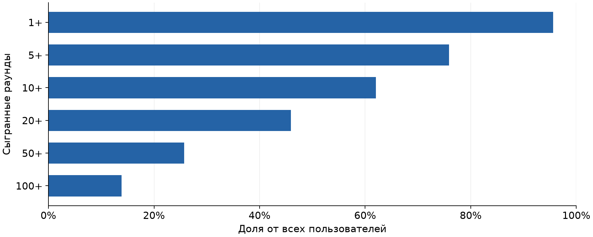
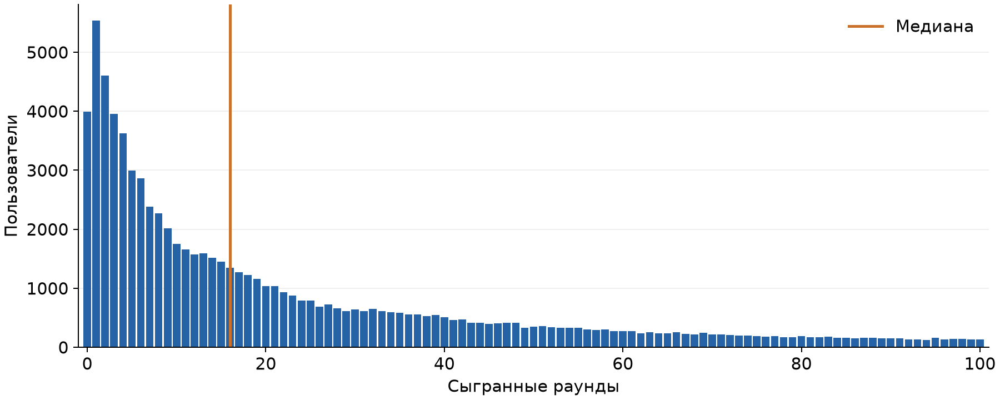
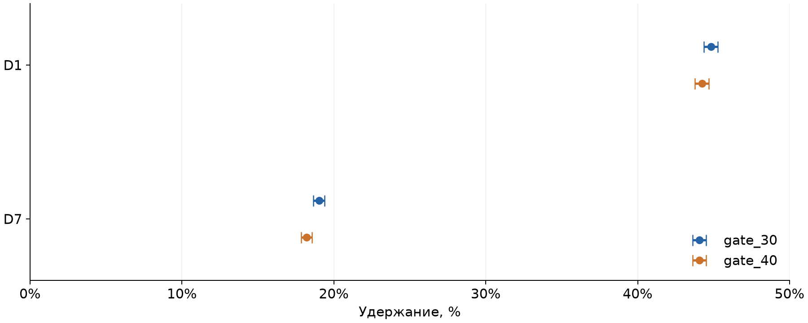
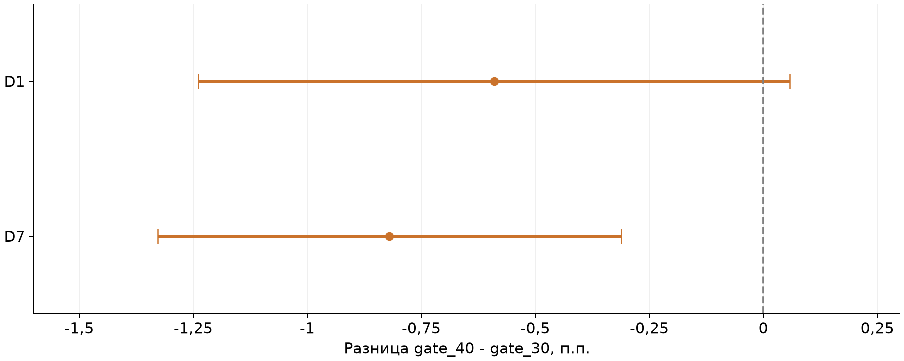
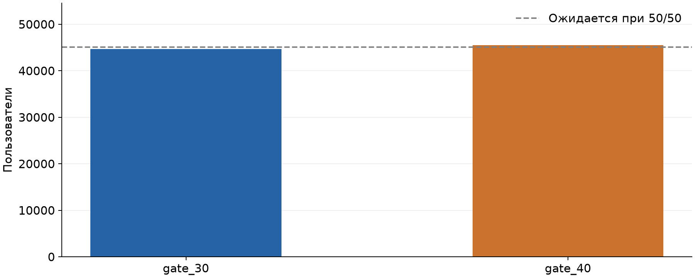

# Cookie Cats: анализ вовлечённости и A/B-теста

**Автор: [Сергей Ларионов](https://github.com/sirgay1)**  
Python · Pandas · NumPy · SciPy · Statsmodels · Matplotlib

## О проекте

В этом проекте я исследовал поведение **90 189 пользователей** мобильной игры Cookie Cats и сравнил две версии с разным расположением игровых ворот: на 30-м и 40-м уровне. Моя задача — оценить вовлечённость и удержание, проверить качество выборки и сформулировать рекомендацию по результатам эксперимента.

Это самостоятельный учебный анализ открытого датасета. Я рассмотрел эксперимент ретроспективно: исходной конфигурации распределения и заранее утверждённого плана теста в данных нет.

**Главный результат:** в версии `gate_40` наблюдаемое удержание D7 ниже на **0,82 п.п.** Однако проверка распределения участников выявила сигнал SRM при принятом α = 0,05. Поэтому моя рекомендация — проверить формирование выборки до принятия решения о внедрении.

**[Открыть исследование с кодом и результатами →](main.ipynb)** · **[Читать краткий PDF-отчёт →](report.pdf)**

## Данные

В файле [`data/cookie_cats.csv`](data/cookie_cats.csv) находится таблица в формате CSV. Одна строка — один пользователь.

| Поле | Описание |
|---|---|
| `userid` | Идентификатор пользователя |
| `version` | Вариант эксперимента: `gate_30` или `gate_40` |
| `sum_gamerounds` | Количество сыгранных раундов за период наблюдения |
| `retention_1` | Вернулся ли пользователь на первый день после установки |
| `retention_7` | Вернулся ли пользователь на седьмой день после установки |

Я проверил пропуски, уникальность идентификаторов, состав групп, типы данных и допустимость значений. Пропусков и повторяющихся `userid` нет. Для основного анализа использовал всю выборку, включая пользователей с нулём раундов и максимальным значением активности.

## 1. Вовлечённость пользователей

Чтобы оценить глубину активности, я рассчитал долю пользователей, сыгравших не менее 1, 5, 10, 20, 50 и 100 раундов. Знаменатель каждого показателя — вся выборка.

### Доля пользователей, сыгравших не менее N раундов



Не менее пяти раундов сыграли **75,9%** пользователей, не менее ста — **13,9%**. От нуля до пяти раундов включительно сыграли **27,4%**. Пороги вложены друг в друга, поэтому их доли не складываются. Отдельно я сгруппировал пользователей по непересекающимся интервалам: [таблица распределения](tables/bins.csv).

### Распределение числа раундов



Медиана активности — **16 раундов**, среднее — **51,87**. Распределение имеет длинный правый хвост: **13,7%** пользователей сыграли больше ста раундов и находятся за пределами показанного диапазона графика.

Я отдельно проверил влияние максимума **49 854 раунда** на среднее:

| Выборка | Пользователи | Среднее раундов | Медиана |
|---|---:|---:|---:|
| Все пользователи | 90 189 | 51,87 | 16 |
| Без одного максимального значения, проверка чувствительности | 90 188 | 51,32 | 16 |

Одно наблюдение заметно влияет на среднее, но не объясняет весь разрыв между средним и медианой. Я сохранил его в основном анализе: для удаления нужны дополнительные основания.

## 2. Удержание и результат A/B-теста

Для сравнения долей я использовал двусторонний z-тест. Для отдельных показателей удержания рассчитал 95%-е интервалы Уилсона, для разницы `gate_40 − gate_30` — интервалы Ньюкомба.

### Удержание и 95%-е интервалы Уилсона



| Метрика | gate_30 | gate_40 | Разница, п.п. | 95%-й интервал разницы, п.п. | p-value |
|---|---:|---:|---:|---:|---:|
| D1 | 44,82% | 44,23% | −0,59 | [−1,24; +0,06] | 0,0744 |
| D7 | 19,02% | 18,20% | −0,82 | [−1,33; −0,31] | 0,0016 |

### Разница удержания и 95%-е интервалы Ньюкомба



На D7 наблюдается более низкое удержание в `gate_40`: точечный интервал разницы не включает ноль. Для D1 интервал включает ноль; этого недостаточно, чтобы сделать вывод о равенстве версий.

## 3. Проверка распределения участников

Я проверил численность групп относительно предполагаемого распределения 50/50 с помощью критерия χ². Уровень значимости для этой проверки — **0,05**.



В `gate_30` попали **44 700** пользователей, в `gate_40` — **45 489**. Результат: χ² = **6,9024**, p = **0,0086**. При выбранном пороге это сигнал SRM. Он требует проверки, хотя сам по себе не устанавливает причину дисбаланса.

## Выводы и рекомендации

- **Вовлечённость:** для типичного пользователя медиана информативнее среднего. Показатели глубины активности помогают описать аудиторию и выделить вопросы для дальнейшего исследования.
- **Эксперимент:** в данных наблюдается разница удержания D7 в пользу `gate_30`, однако неустранённый SRM ограничивает её причинную интерпретацию. Я не рекомендую принимать решение о внедрении до проверки выборки.
- **Следующий шаг:** подтвердить плановую пропорцию групп, проверить логи назначения, правила исключения и полноту окна наблюдения D1/D7. После расследования повторить расчёты.
- **Дальнейшее исследование:** для проверки причин низкой активности потребуются события туториала, ошибки и источники трафика. Для нового теста нужно заранее определить основную метрику, минимально полезный эффект, мощность и длительность.

### Ограничения

Количество сыгранных раундов не определяет достигнутый уровень, момент или причину ухода. В таблице нет дат, событий, покупок и выручки. Доверительные интервалы и p-value точечные, без поправки на множественные сравнения; возможное смещение из-за SRM в них не учтено. Результаты описывают учебную выборку, а не измеренный эффект внедрения.

## Практическое применение

В проекте я показал полный цикл аналитической работы: от проверки выгрузки до визуализации, оценки неопределённости и рекомендации. Такой подход применим к задачам интернет-магазина: изучению клиентской активности, повторных покупок и результатов экспериментов. Для анализа покупательской воронки потребуются события просмотра товара, корзины, оформления и оплаты с идентификаторами и временем.

## Структура проекта

```text
Cookie-Cats-Final/
├── README.md                 Описание исследования и основные результаты
├── main.ipynb                Весь код, расчёты, графики и выводы
├── data/cookie_cats.csv       Исходные данные
├── figures/                  Пять графиков Matplotlib
├── tables/                   Расчётные таблицы и сводка показателей
├── report.pdf                Аналитический отчёт на четырёх страницах
└── requirements.txt          Зависимости для выполнения ноутбука
```

Код исследования полностью находится в `main.ipynb`. Заголовки, пояснения и выводы оформлены текстовыми Markdown-ячейками. Пять графиков строятся в Matplotlib; отдельные PNG-файлы используются для просмотра результатов в README.

## Как посмотреть и повторить анализ

Ноутбук уже выполнен: код, таблицы и графики можно просмотреть на GitHub или локально. Краткие результаты собраны в [PDF-отчёте](report.pdf).

Для повторного выполнения нужен Python 3.11 или новее. В Windows PowerShell из папки проекта:

```powershell
python -m venv .venv
.venv\Scripts\python -m pip install -r requirements.txt
```

Откройте `main.ipynb` в VS Code или Jupyter, выберите созданное окружение `.venv` и выполните ячейки по порядку. Рабочая папка — папка проекта с `main.ipynb`. На macOS/Linux вместо `.venv\Scripts\python` используйте `.venv/bin/python`.

Ноутбук читает локальный файл `data/cookie_cats.csv` и обновляет результаты в `figures/` и `tables/`. Все данные для выполнения уже включены в проект. PDF содержит краткий срез результатов исследования; выполнение ноутбука обновляет таблицы и графики.

## Источники и методы

- Данные: открытый датасет Cookie Cats, используемый в учебном проекте [Mobile Games A/B Testing with Cookie Cats, DataCamp](https://app.datacamp.com/learn/projects/184). Копия данных включена в репозиторий; анализ и оформление представлены в этом проекте.
- [Microsoft: диагностика Sample Ratio Mismatch](https://www.microsoft.com/en-us/research/articles/diagnosing-sample-ratio-mismatch-in-a-b-testing/).
- [Statsmodels: интервалы долей](https://www.statsmodels.org/stable/generated/statsmodels.stats.proportion.proportion_confint.html), [разница долей](https://www.statsmodels.org/stable/generated/statsmodels.stats.proportion.confint_proportions_2indep.html), [z-тест](https://www.statsmodels.org/stable/generated/statsmodels.stats.proportion.proportions_ztest.html).
